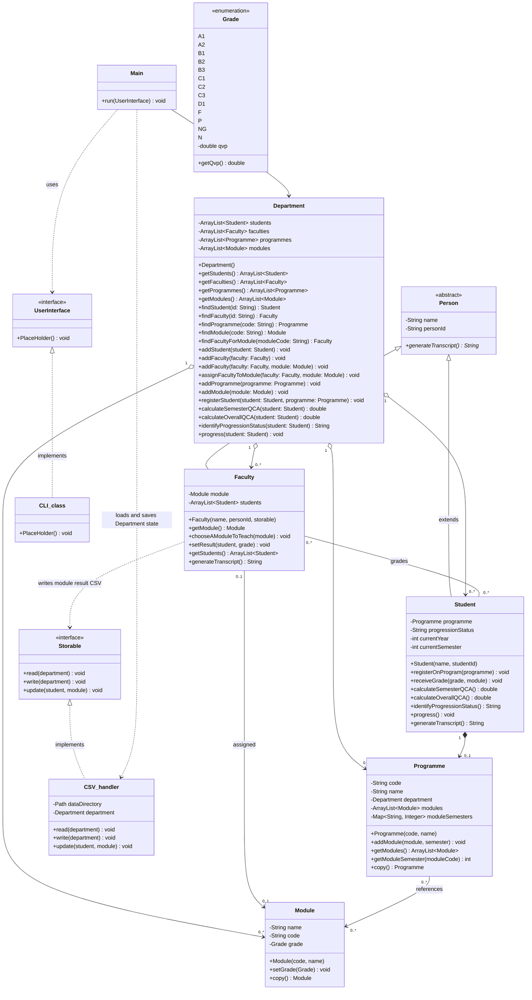

# CS4013 Student Record System – UML Class Diagram

## Container model

Each `Student` owns a copy of their `Programme`, which owns copies of its `Module` objects:

`Student[Programme[Module1[Grade?], Module2[Grade?], ...]]`

- `Department` owns the shared programme/module catalog in memory.
- `CSV_handler` loads records into an empty Department and persists the current
  Department state; it may keep a reference to that Department for immediate
  grade updates, but does not keep a second copy of the entity collections.
- `Student.registerOnProgram(programme)` copies the programme, its module-semester mapping, and its modules. A copied module starts with a null grade; an explicit `NG` is a recorded grade.
- `Faculty.setResult(student, grade)` checks that the student's programme contains the taught module, then records the grade on that student's module copy.
- The module result CSV stores one current grade per student and module; there is no result ID, attempt history, or result-specific semester.
- Semester numbers increase across the whole course. `calculateSemesterQCA()` uses `currentSemester` and the copied programme's module-semester mapping; `generateTranscript()` lists recorded grades with their curriculum semesters.
- Handbook `NG` has 0.00 QPV and is included in QCA; ungraded null grades are excluded. Pass/fail `P` and `N` are non-quality grades.
- `Department.identifyProgressionStatus(student)` sets the student's status to `PROGRESS` when their overall QCA is at least 2.00, and to `REPEAT` otherwise.
- `Department.progress(student)` advances the student to the next semester only when their progression status is `PROGRESS`.

## Relationship summary

| From | Relationship | To | Multiplicity |
|---|---|---|---|
| Student | Inheritance (extends) | Person | – |
| Faculty | Inheritance (extends) | Person | – |
| CLI_class | Realization (implements) | UserInterface | – |
| CSV_handler | Realization (implements) | Storable | – |
| Main | Association (uses) | Department | – |
| Main | Dependency (uses) | CLI_class | – |
| Faculty | Dependency (uses) | Storable | – |
| Department | Aggregation | Faculty | 1 Department to 0..* Faculty |
| Department | Aggregation | Student | 1 Department to 0..* Student |
| Department | Aggregation | Programme | 1 Department to 0..* Programme |
| Department | Aggregation | Module | 1 Department to 0..* Module |
| Faculty | Association | Module | 0..1 per Faculty; at most 1 Faculty per Module |
| Faculty | Association | Student | 0..* per Faculty |
| Student | Composition | Programme copy | 0..1 per Student |
| Programme | Association (references catalogue modules) | Module | 0..* per Programme; modules may be shared |